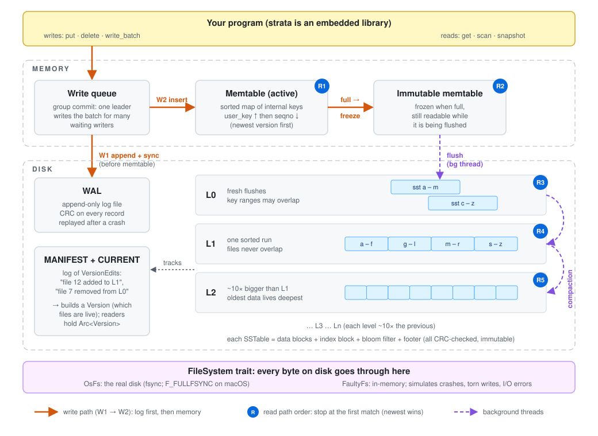

# strata

An embedded key-value storage engine in Rust, built from scratch on a **log-structured merge-tree (LSM)**: the same family of designs behind LevelDB, RocksDB and Cassandra. It's a library you link into your program, not a server.

I'm building it in small milestones. Each milestone has its own code, tests and a learning chapter that explains what the layer does, why it's designed that way, and which alternatives were rejected.

> **Status:** milestone 0 of 11. Project scaffold. See the [milestone table](docs/specs/2026-11-18-lsm-engine-design.md#8-milestones-each-ends-at-a-stop-point).



## Where to read

| | |
|---|---|
| [Design](docs/specs/2026-11-18-lsm-engine-design.md) | goals, architecture, testing and benchmark strategy |
| [Learning chapters](docs/learn/) | one chapter per milestone: what, why, alternatives, how real systems do it |
| [Interview notes](docs/interview/) | questions and answers per chapter |

## Build and test

```bash
cargo test
```

## License

Licensed under either of [MIT](LICENSE-MIT) or [Apache-2.0](LICENSE-APACHE), at your option.
