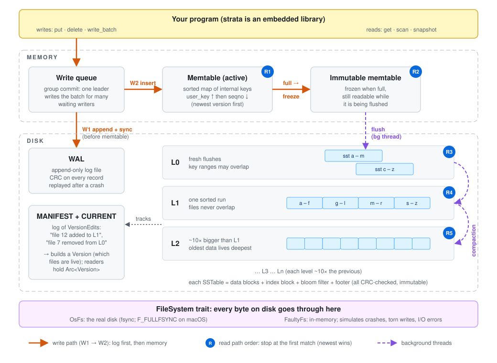

# Chapter 00: Why an LSM tree?

> **Goal of this chapter:** before writing any engine code, understand *what problem* an LSM tree solves, what it costs, and how the pieces in the architecture diagram fit together. Every later chapter zooms into one box of that diagram.

---

## 1. What it is

A **storage engine** is the part of a database that answers two questions:

- *Write:* "Remember that key `user:42` now has value `{...}`, even if the power goes out one millisecond later."
- *Read:* "What is the current value of `user:42`?" (and "give me every key between `user:40` and `user:50`").

A **log-structured merge-tree (LSM tree)** is one way to build it. The idea in one sentence:

> **Never update data in place. Append every change, keep recent changes sorted in memory, and periodically write them out as sorted, immutable files that get merged in the background.**

"Log-structured" means writes only ever *append*. "Merge-tree" means the on-disk files are organised into levels that are repeatedly *merged* into each other.

The design was published by O'Neil et al. in 1996 ("The Log-Structured Merge-Tree"). Google's Bigtable made it famous in 2006, and LevelDB (2011) and RocksDB (2012) turned it into the embedded libraries most of the industry uses today.

---

## 2. Why we need it: the cost of updating data in place

### The disk has a strong preference

Storage devices are far better at *sequential* work than *scattered* work.

| Device | Sequential write | Small random write |
|---|---|---|
| Spinning disk (HDD) | ~150 MB/s | ~100–200 writes/s. Each one needs the head to *seek*, about 5–10 ms |
| SSD | GB/s | Much better than an HDD, but still costly. Flash can't overwrite in place: it erases big blocks (hundreds of KB to MB) and the SSD firmware moves data around to do it. Scattered small writes make the SSD do extra internal copying. |

On top of the device, there's **durability**. A write isn't safe until you ask the OS to flush it to stable storage (`fsync`). Each flush is a round trip to the hardware and costs a few milliseconds, *no matter how few bytes you wrote*.

### The experiment (run it yourself)

`examples/write_patterns.rs` stores 500 records of 100 bytes durably, three ways:

```
cargo run --release --example write_patterns
```

Results on the machine this chapter was written on (Apple M3, macOS 26.6, internal SSD):

```
in-place              244 records/s   4.09 ms/record   bytes written: 2048000  (41x the data)   syncs: 500
append                342 records/s   2.92 ms/record   bytes written:   50000  ( 1x the data)   syncs: 500
append+batch        24393 records/s   0.04 ms/record   bytes written:   50000  ( 1x the data)   syncs: 5
```

What this shows:

1. **In-place** (how a B-tree updates a page) rewrites a full 4 KiB page to change 100 bytes. That's 41× more bytes than the data itself, and each write lands somewhere random.
2. **Append** writes only the bytes you changed. But one `fsync` per record still dominates, so it's only modestly faster.
3. **Append + batch** syncs once for 100 records, and it's **about 70× faster** than syncing each one. The `fsync` cost is shared by all the records in the batch.

An LSM tree is built so that *every* write takes path 3. The write-ahead log appends, and many writers share one sync (**group commit**, milestone 8). The data files are written in large sequential chunks.

> **macOS note:** Rust's `File::sync_all` uses `F_FULLFSYNC` on Apple platforms, which really does force the drive to flush its cache. Plain `fsync` on macOS doesn't guarantee that. That's why per-sync costs here are a few milliseconds. On Linux the numbers will differ. The *ratio* between batching and not batching is what matters.

---

## 3. How ours works



### The write path (orange)

1. **W1: append to the WAL.** The write-ahead log is a plain append-only file. Writing here first means that if we crash a moment later, we can replay the log on restart. Writes aren't lost. *(Milestone 2.)*
2. **W2: insert into the memtable.** The memtable is an in-memory sorted map. It's cheap to update, and it keeps keys in order so it can later be written out as a sorted file. *(Milestone 1.)*
3. **Freeze and flush.** When the memtable reaches a size limit (4 MiB by default), it becomes *immutable*. A fresh memtable takes new writes, and a background thread writes the frozen one to disk as a **sorted string table (SSTable)** in level 0. *(Milestones 3–4.)*

At no point do we modify an existing file. SSTables are written once and never changed. That makes crash safety and concurrent reading much simpler, because nobody can see a half-updated file.

### The read path (blue, R1 → R5)

The same key may exist in several places, for example an old value in L2 and a newer value in the memtable. **The newest copy wins**, so a read checks from newest to oldest and stops at the first hit:

```
R1 memtable → R2 immutable memtable → R3 L0 files (newest first) → R4 L1 → R5 L2 → …
```

Two tricks keep this fast:

- **Bloom filters.** Each SSTable has a small bit array that answers "is this key *definitely not* here?" That lets us skip most files without reading them. *(Milestone 4.)*
- **Levels below L0 don't overlap.** In L1 and deeper, each key range belongs to exactly one file, so at most one file per level needs checking. *(Milestones 6–7.)*

### Deletes

You can't "remove" something from an immutable file. A delete is just another write: a **tombstone** that says "this key is deleted as of now." The read path sees the tombstone first (it's newer) and reports *not found*. Compaction eventually drops both the tombstone and the old value. *(Milestones 1 and 7.)*

### Background work (purple)

**Compaction** merges SSTables from one level into the next. It throws away overwritten values and tombstones, and keeps each level sorted and non-overlapping. Each level is about 10× bigger than the one above, so most data lives in the deepest level. *(Milestone 7.)*

### Bookkeeping

The **MANIFEST** is a log of changes like "file 12 added to L1" and "file 7 removed from L0". Replaying it on startup tells us which files are live. *(Milestone 5.)*

---

## 4. The price: three kinds of amplification

Nothing is free. Storage engines are compared with three numbers:

| Term | Definition | Where it comes from in an LSM |
|---|---|---|
| **Write amplification** | bytes written to disk ÷ bytes the user wrote | Every value is written to the WAL once, flushed to L0 once, then rewritten by compaction as it moves down each level |
| **Read amplification** | disk reads per user read | A lookup may check several L0 files plus one file per deeper level. Bloom filters cut this down. |
| **Space amplification** | disk space used ÷ size of live data | Overwritten values and tombstones take space until compaction removes them |

### A worked example (leveled compaction, size ratio 10)

You write **1 KB** of new data:

- WAL: 1 KB written.
- Flush to L0: 1 KB written.
- L0 → L1 compaction: 1 KB (plus whatever overlapping L1 data gets rewritten with it).
- **Each deeper level:** when a file moves from Lₙ to Lₙ₊₁, it's merged with the overlapping files there. Lₙ₊₁ is about 10× bigger, so in the worst case we rewrite about 10 KB of neighbours to place our 1 KB.

With 4 levels the worst case is roughly `1 + 1 + 1 + 10 + 10 + 10 ≈ 33×`. Real systems usually see **10–30×**. That's the price an LSM pays for turning random writes into sequential ones. It's often worth it, because sequential bytes are so much cheaper than random syncs (see the experiment).

Space amplification is low with leveled compaction (about 1.1×). About 90% of the data sits in the last level, and that level has at most one copy of each key.

This three-way tension has a name: the **RUM conjecture** (Athanassoulis et al., 2016). You can optimise for **R**ead overhead, **U**pdate overhead or **M**emory/space overhead, but not all three at once.

---

## 5. Alternatives we rejected, and why

### B+tree (SQLite, InnoDB, PostgreSQL indexes, LMDB)

Data lives in fixed-size pages arranged as a balanced tree, and it's updated **in place**.

- ✅ Reads are fast and predictable: walk a few pages from root to leaf, often cached.
- ✅ Each key exists in exactly one place, so there's no compaction and no tombstones.
- ❌ Updates are random writes, and small changes rewrite whole pages (the 41× in our experiment).
- ❌ Crash safety still needs a WAL, *plus* care with half-written pages (torn pages).

**Why not for strata:** the project's goal is to learn the write-optimised design used by RocksDB-family engines. We'll still compare against B-trees throughout, because "LSM or B-tree?" is the classic interview question.

### Bitcask (Riak, 2010)

This is the simplest log-structured design: an append-only log, plus an in-memory hash map from every key to its position in the log.

- ✅ Writes are appends. Reads take one disk access. It's very simple.
- ❌ **Every key must fit in RAM** (the hash map).
- ❌ **No range scans.** A hash map has no order.

**Why not for strata:** too small in scope, and range scans are a goal. Bitcask is a useful stepping stone, though: an LSM is roughly "Bitcask, but sorted, so the index doesn't need to hold every key."

### Summary

| | B+tree | LSM tree | Bitcask |
|---|---|---|---|
| Write pattern | random, in place | sequential, append | sequential, append |
| Point read | ~1–3 page reads | memtable + bloom-filtered files | 1 read |
| Range scan | ✅ excellent | ✅ good (merge sorted runs) | ❌ |
| Write amplification | high for small updates (page rewrite) | 10–30× from compaction | low until log cleanup |
| Background work | little | compaction (must keep up) | log merging |
| Keys must fit in RAM | no | no | **yes** |

---

## 6. How real systems do it

- **LevelDB** (Google): the reference design strata follows most closely. It has a WAL, memtable (skiplist), SSTables with block index and bloom filter, MANIFEST + CURRENT, and leveled compaction.
- **RocksDB** (Meta): a LevelDB fork tuned for SSDs and servers. It adds column families, multiple compaction styles (leveled, universal/tiered, FIFO), a block cache, rate limiting and many tuning options. TiKV, CockroachDB (until it moved to Pebble), Kafka Streams and many others embed it.
- **Pebble** (Cockroach Labs): a RocksDB-compatible LSM written in Go, now CockroachDB's engine.
- **Cassandra / ScyllaDB**: distributed databases whose per-node storage is an LSM. They default to *size-tiered* compaction, which trades more space for less write amplification.
- **WiredTiger** (MongoDB): a B-tree by default, which shows that both designs remain mainstream.

---

## 7. Milestone map

| Milestone | Builds which part of the diagram |
|---|---|
| 1 | Internal keys (sequence numbers, tombstones) + memtable |
| 2 | WAL + FileSystem trait + recovery |
| 3 | SSTable format |
| 4 | Bloom filters + flush to L0 |
| 5 | MANIFEST / version set |
| 6 | Multi-level reads and range scans (merging iterators) |
| 7 | Leveled compaction |
| 8 | Snapshots, concurrency, group commit |
| 9 | Crash and fault-injection test suite |
| 10 | Benchmarks (+ optional RocksDB comparison) |
| 11 | Polish and "telling the story" |

---

## 8. Try it yourself

1. Run the experiment and compare your numbers with the ones above:
   `cargo run --release --example write_patterns`
2. In `examples/write_patterns.rs`, change `BATCH` from `100` to `10` and then to `1000`. How do records/s change? Why does the improvement eventually flatten out? *(Hint: once syncs are rare, what's the next bottleneck?)*
3. Change `PAGE` to `16384` (InnoDB's page size). What happens to "bytes written ×"?
4. Explain to yourself, without looking: why can't an LSM delete a key by just removing it from a file?

## Check yourself

- Can you say in one sentence why an LSM is fast at writes?
- Can you name the three amplifications and which one an LSM sacrifices?
- Can you trace a `get` through the diagram, and say where it stops?

If any of these feel fuzzy, that's the question to ask before milestone 1.
