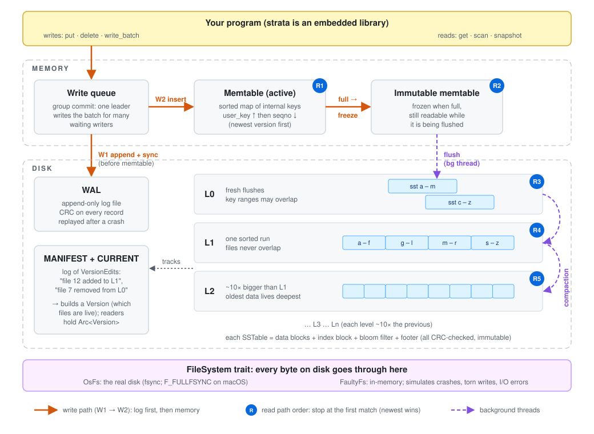

# strata: Embedded LSM Storage Engine, Design

*Working name. Status: draft, awaiting approval.*

## 1. Intent and why

We're building an embedded key-value storage engine in Rust, based on the **log-structured merge-tree (LSM)** design used by RocksDB, LevelDB, Cassandra and many others. It serves three goals equally:

1. **Understanding.** You should be able to explain every layer, from "`put` returns" down to "the bytes are durable on disk", and why each layer exists.
2. **Portfolio.** A clean repo with a readable commit history, real tests, crash/fault testing, honest benchmarks and good docs.
3. **Interviews.** The material covers the storage-engine questions that come up in database and systems interviews: write amplification, compaction strategies, bloom filters, fsync semantics, MVCC snapshots, and recovery.

"Embedded" means it's a library linked into your program, like SQLite or RocksDB, not a network server.

## 2. Goals, non-goals, anti-goals

**Goals**
- Public API: `open`, `put`, `get`, `delete`, atomic `WriteBatch`, `snapshot`, range `scan` (iterator), `flush`, `close`.
- Durable writes through a write-ahead log (WAL), with a configurable sync policy.
- On-disk sorted tables (SSTables) with block index, bloom filter and checksums.
- Leveled compaction running in the background.
- Point-in-time snapshots (MVCC via sequence numbers).
- Concurrent readers and writers. Group commit batches many writers into one disk sync.
- Crash recovery that's proven by tests, including torn writes and lost unsynced data.
- Benchmarks with a reproducible method, plus an optional comparison against RocksDB.

**Non-goals** (explicitly out of scope; mentioned in docs as "how you'd extend it")
- Network server or replication. The Raft project covers that.
- Multi-key transactions beyond atomic batches. No optimistic or pessimistic transactions.
- Column families, TTL, merge operators, compression codecs. Compression may be an optional stretch.
- Windows support.

**Anti-goals** (failure even if it "works")
- Code you can't explain. Every non-obvious choice gets a "why" in the learning chapter.
- Benchmarks presented without method, or tuned to make comparisons look good.
- Copying another project's layout, wording or claims.
- A big-bang commit history. Each milestone must read as its own step.

## 3. Constraints

- Rust stable (1.95 on this machine). macOS is the development platform; code should also work on Linux.
- **macOS durability caveat:** plain `fsync` on macOS doesn't guarantee data reaches stable storage. Rust's `File::sync_all` uses `F_FULLFSYNC` on Apple platforms, which is real but slow. Durable-write benchmark numbers will therefore differ from Linux numbers. The benchmark docs state this.
- Minimal, well-known dependencies. Every dependency is justified in its chapter:
  - `crc32fast` (checksums)
  - `parking_lot` (locks)
  - `crossbeam-channel` (background work queue)
  - `thiserror` (error type)
  - Dev-only: `proptest` (property tests), `criterion` (micro-benchmarks), `tempfile`.
  - Optional: `rocksdb`, behind a `bench-rocksdb` feature, because it's a heavy native C++ build.
- We hand-write the core data structures: WAL format, SSTable format, bloom filter, manifest, compaction. That's the point of the exercise.

## 4. Approaches considered

| Approach | Trade-off | Verdict |
|---|---|---|
| **LSM tree (LevelDB/RocksDB style)** | Fast writes (sequential I/O) and good compression. Reads may touch several files, which bloom filters mitigate. Background compaction costs write amplification. | **Chosen.** It's what the goal asks for, and it's the most common interview topic. |
| B+tree (like SQLite, InnoDB) | Faster, predictable reads; in-place updates; harder crash safety (needs a WAL anyway, plus page management). | Rejected for this project. The docs will compare it, because "LSM vs B-tree" is a classic interview question. |
| Bitcask (log + in-memory hash index) | Very simple and fast point reads, but no range scans, and all keys must fit in RAM. | Rejected: too small in scope. We'll mention it as the simplest log-structured design. |

**Build approach (chosen by you): staged milestones.** Each milestone has code + tests, a learning chapter, interview Q&A, and a stop point.

## 5. Architecture



**How to read it:**
- **Write (orange).** The write goes to the WAL on disk first (W1), so a crash can't lose it. Then it goes to the in-memory memtable (W2).
- **Read (blue, R1 → R5).** A read checks the newest data first and stops at the first match: memtable, then the frozen memtable, then L0, L1, L2….
- **Background threads (purple).** They flush full memtables to L0 and compact each level down into the next.
- **MANIFEST.** It records which SSTable files are live at which level.
- **FileSystem trait.** All I/O goes through it, so tests can swap in a fake disk that "crashes".

Text version of the same picture:

```
            put / delete / write_batch                  get / scan / snapshot
                     │                                        │
              ┌──────▼──────┐                          ┌──────▼───────┐
              │ Write queue │  group commit            │ Read path    │
              │ (leader     │  (one leader writes      │ memtable →   │
              │  batches)   │   for many writers)      │ immutable →  │
              └──────┬──────┘                          │ L0 → L1 → …  │
          1. append  │  2. insert                      └──────▲───────┘
         ┌───────────▼──┐  ┌──────────────┐                   │
         │ WAL (log file│  │ Memtable     │──full──► Immutable memtable
         │  + CRC)      │  │ (sorted map) │                   │ flush (background)
         └──────────────┘  └──────────────┘                   ▼
                                                     ┌──────────────────┐
     MANIFEST (log of VersionEdits) ◄────────────────│ SSTables in levels│
     CURRENT → which manifest is live                │ L0: overlapping   │
                                                     │ L1+: sorted runs  │
                                                     └────────▲─────────┘
                                                              │ compaction (background)
```

### Key components

**Internal key.** Fixed from milestone 1 because it's painful to retrofit. The format is `user_key ++ (seqno << 8 | kind)`:
- `seqno` is a 56-bit global sequence number.
- `kind` is `Put` or `Delete` (a tombstone).

Ordering is user key ascending, then seqno *descending*, so the newest version of a key sorts first. Snapshots, deletes and compaction all build on this ordering.

**Memtable.** An in-memory sorted map of internal keys. We start with `BTreeMap` behind a lock, because it's simple and obviously correct. A later milestone may swap in a skiplist, with the reason explained. When it exceeds `memtable_size`, it becomes immutable and a new one is created.

**WAL.** Every write batch is appended to the log *before* it's applied to the memtable.
- **Record format:** `[crc32 | length | type | payload]`, split into fixed 32 KB blocks (LevelDB-style), so a torn tail can be detected and skipped.
- **Sync policy:** `Always` (fsync per commit, or per group), `EveryN`, or `Never`.
- One WAL per memtable. It's deleted once that memtable is flushed and recorded in the manifest.

**Storage trait (`Env` / `FileSystem`).** All file I/O goes through a trait that's introduced at the WAL milestone. There are two implementations:
- the real OS filesystem
- `FaultyFs`, in memory, which can simulate a crash (dropping all un-synced bytes), torn writes, failed syncs and I/O errors

This is what makes crash testing possible without pulling the power cord.

**SSTable format.**
- **Data blocks:** about 4 KB, keys prefix-compressed with restart points every 16 keys, so binary search within a block works.
- **Index block:** the last key of each data block, plus its offset.
- **Filter block:** a bloom filter over user keys, about 10 bits/key, roughly 1% false positives.
- **Footer:** offsets of the index and filter blocks, a format version and a magic number.
- Every block carries a CRC.
- Files are immutable once written.

**Version set / manifest.** It's its own milestone because reads across levels, compaction and recovery all depend on it.
- A `Version` is an immutable snapshot of "which SSTables exist at which level".
- Changes are written as `VersionEdit` records to a MANIFEST log, which uses the same record format as the WAL.
- The `CURRENT` file names the live manifest and is updated by atomic rename.
- Readers hold an `Arc<Version>`, so files they're using aren't deleted under them.

**Compaction (leveled).**
- L0 holds freshly flushed tables whose key ranges may overlap.
- From L1 on, each level is one sorted, non-overlapping run, about 10× larger than the level above.
- A background thread picks the level with the highest score (size / target), merges the overlapping files into the next level, drops versions no live snapshot can see, and drops tombstones at the bottom level.
- The chapter covers write, read and space amplification, and compares leveled with tiered/universal compaction.

**Snapshots.** A snapshot records the current seqno. Reads through it ignore entries with a higher seqno. Compaction keeps the newest version at or below each live snapshot.

**Concurrency.**
- **Writers:** queue up and a leader writes the combined batch to the WAL with one sync (group commit), then applies it to the memtable.
- **Readers:** take no write lock. They grab the current memtable/immutable/version references and read.
- **Background work:** one flush thread and one compaction thread, communicating over channels.

**Recovery on `open`:**
1. Read `CURRENT`, then the manifest, to rebuild the Version.
2. Replay any WAL files newer than the last flush into a memtable.
3. Discard a torn tail record with a bad CRC. Stop at corruption according to the `paranoid` option.
4. Restore the seqno.

**Errors.** One `Error` enum (`Io`, `Corruption`, `InvalidArgument`, `Closed`). Corruption is always reported, never silently ignored, except for the expected torn WAL tail.

## 6. Testing strategy

Correctness comes first, so these tests run from milestone 1:

- **Model test (oracle).** `proptest` generates random sequences of put, delete, get, scan, flush, reopen and snapshot. They run against strata and against a plain `BTreeMap`, and the results must match. The test is extended at every milestone.
- **Crash tests.** These run on `FaultyFs`: run random operations, "crash" at random points, reopen, and check two things:
  - every write acknowledged under `SyncPolicy::Always` is present
  - nothing appears that was never written
- **Fault injection.** Failed syncs, I/O errors and corrupted bytes must produce an error, never wrong data.
- **Format unit tests** for blocks, bloom filter, WAL records and the manifest.
- **Concurrency tests.** Many writer and reader threads, checked against the model.

## 7. Benchmarks

- `criterion` micro-benchmarks for block search, bloom lookup and memtable insert.
- A `strata-bench` binary for workloads:
  - fill sequential / random
  - read random (warm and cold)
  - scan
  - durable writes at 1, 4 and 16 writers (shows the group-commit effect)
- Report p50/p99 latency and ops/s, with hardware, OS, file system, sync policy and dataset size listed.
- Optional `--features bench-rocksdb` runs the same workloads on RocksDB, with the configuration printed in full.
- **No target numbers are set in advance.** We report what this machine actually does.

## 8. Milestones (each ends at a stop point)

| # | Milestone | Learning chapter covers |
|---|---|---|
| 0 | Repo scaffold, API skeleton, error type, CI | Why LSM; LSM vs B-tree vs Bitcask; project tour |
| 1 | Internal key encoding + memtable + in-memory DB + model test | Sequence numbers, tombstones, key ordering, why `BTreeMap` first |
| 2 | `FileSystem` trait + WAL + recovery from WAL | Write-ahead logging, fsync semantics (incl. macOS), CRCs, torn writes |
| 3 | SSTable writer/reader: blocks, index, footer, checksums | Block layout, prefix compression, restart points, immutability |
| 4 | Bloom filters + flush memtable → L0 | Bloom math, false positive rate, flush lifecycle |
| 5 | Version set + manifest + `CURRENT` | Metadata atomicity, atomic rename, reference counting files |
| 6 | Merging iterators, multi-level reads, range scans | k-way merge, iterator design, read amplification |
| 7 | Leveled compaction (background) | Write/space/read amplification, leveled vs tiered, tombstone dropping |
| 8 | Snapshots + concurrency + group commit | MVCC, lock design, group commit, memory ordering basics |
| 9 | Crash and fault-injection test suite (`FaultyFs`) | Testing for durability, how FoundationDB/TigerBeetle test |
| 10 | Benchmarks + optional RocksDB comparison + tuning | Benchmark honesty, profiling, where the time goes |
| 11 | Polish: README, architecture doc, final interview guide | Telling the project's story in an interview |

Deviation from what I first sketched to you: the **version set / manifest** is now its own milestone (5), and the **storage trait** arrives with the WAL (2). Both are foundations that later stages need.

## 9. Repo layout (planned)

```
strata/
  src/  lib.rs  db.rs  key.rs  memtable.rs  wal/  sstable/  bloom.rs
        version/  compaction.rs  iter.rs  fs/ (os.rs, faulty.rs)  error.rs
  tests/      model.rs  crash.rs  concurrency.rs
  benches/    criterion micro-benchmarks
  src/bin/strata-bench.rs
  docs/learn/ 00-why-lsm.md … 11-story.md
  docs/interview/ questions per chapter
  docs/specs/ this design
  README.md  ARCHITECTURE.md  BENCHMARKS.md
```

## 10. Calls I made (please check)

- Start the memtable with `BTreeMap` + lock; consider a skiplist later.
- 32 KB WAL blocks and 4 KB SSTable blocks, about 10 bits/key bloom filter (LevelDB defaults, well documented).
- Single crate, not a workspace. Simpler; we can split later.
- MIT or Apache-2.0 dual licence (standard for Rust).
- GitHub Actions CI running `cargo test`, `clippy` and `fmt` on Linux and macOS.

## 11. Left to the builder

Exact function signatures, module boundaries inside each milestone, option defaults beyond the ones above, and benchmark dataset sizes. Each is decided in the implementation plan and explained in the chapter.
